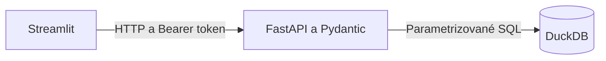
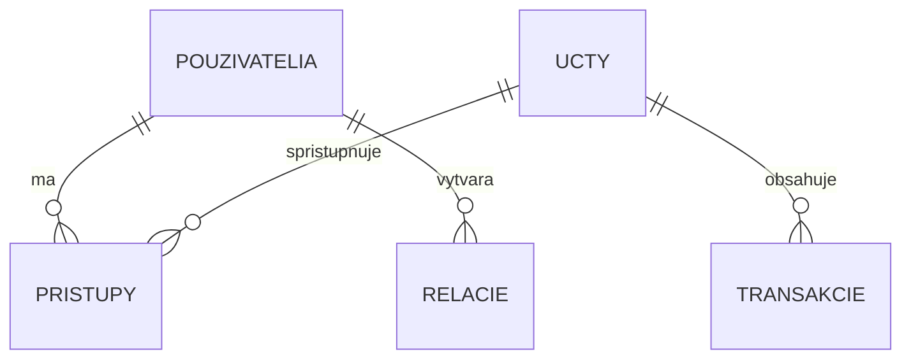
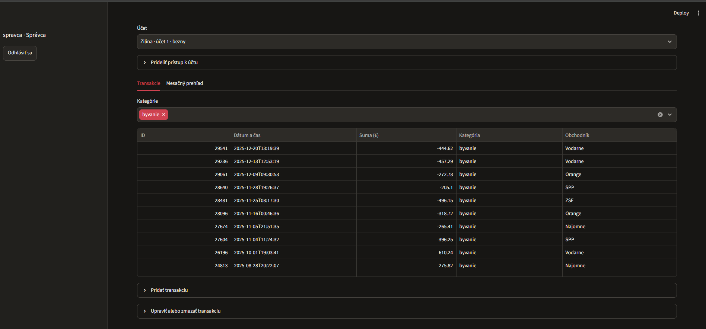
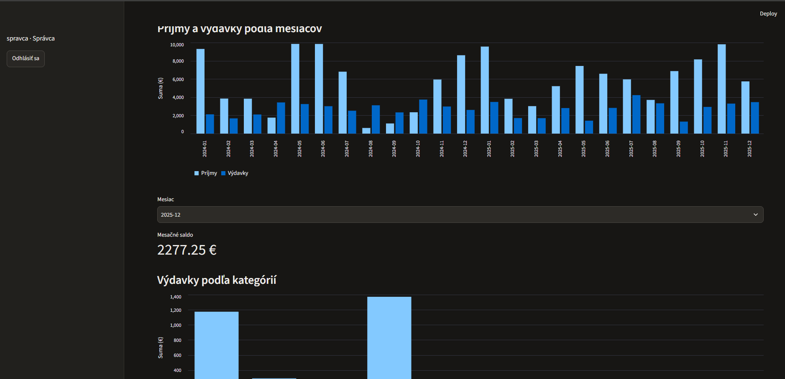

# Osobné financie

Aplikácia na správu transakcií a prehľad príjmov a výdavkov. Správca môže
upravovať transakcie, importovať CSV a prideľovať účty. Člen môže prezerať
iba údaje pridelených účtov.

## Spustenie vo Windows

Použite **Python 3.12**. V PowerShelli otvorte priečinok s `requirements.txt`:

```powershell
py -3.12 -m venv .venv
.\.venv\Scripts\python.exe -m pip install -r requirements.txt
.\.venv\Scripts\python.exe -m uvicorn server.api:app --host 127.0.0.1 --no-proxy-headers
```

Ak `pip` hlási nezhodu kontrolnej sumy, zopakujte inštaláciu:

```powershell
.\.venv\Scripts\python.exe -m pip --isolated install --no-cache-dir --index-url https://pypi.org/simple -r requirements.txt
```

Po hlásení `Application startup complete` spustite klienta v druhom termináli
z rovnakého priečinka:

```powershell
.\.venv\Scripts\python.exe -m streamlit run klient/app.py --server.address 127.0.0.1
```

Pri prvom štarte server pripraví databázu a načíta **30 účtov a 30 000
transakcií** zo súborov `data/ucty.csv` a `data/transakcie.csv`. Otvorte
aplikáciu, vytvorte si účet cez **Vytvorenie prvého správcu** a prihláste sa.
Pri ďalšom spustení stačí spustiť API a klienta a použiť existujúci účet.
[Aplikácia](http://127.0.0.1:8501)

## Používanie

Vyberte účet a filtrujte **Transakcie** podľa kategórie. Na karte
**Mesačný prehľad** vyberte mesiac. Správca môže pridávať, upravovať
a mazať transakcie alebo nahrať CSV cez **Import údajov**. Pri odmietnutom
riadku aplikácia zobrazí číslo riadka a dôvod.

Na overenie oprávnení zaregistrujte člena. Ako správca vyberte účet
a použite **Prideliť prístup k účtu**. Člen po prihlásení uvidí pridelený účet.

## Architektúra a databáza





Tabuľka `pristupy` spája používateľov a účty väzbou M:N. Server overuje
oprávnenia. Heslá ukladá ako bcrypt hashe a v tabuľke `relacie` uchováva
hashe tokenov a čas ich platnosti.

## API

| Metóda | Cesta | Čo robí | Prístup |
|---|---|---|---|
| GET | `/nastavenie` | Zistí, či treba vytvoriť prvého správcu. | Lokálne |
| POST | `/nastavenie` | Vytvorí prvého správcu, ak ešte neexistuje. | Lokálne |
| POST | `/registracia` | Zaregistruje používateľa s rolou člena. | Bez prihlásenia |
| POST | `/prihlasenie` | Overí meno a heslo a vráti prihlasovací token. | Bez prihlásenia |
| GET | `/ja` | Vráti profil prihláseného používateľa. | Prihlásený používateľ |
| POST | `/odhlasenie` | Zruší aktuálnu prihlasovaciu reláciu. | Prihlásený používateľ |
| GET | `/ucty` | Vráti účty dostupné pre používateľa. | Prihlásený používateľ |
| PUT | `/ucty/{ucet_id}/pristupy` | Pridelí používateľovi prístup k vybranému účtu. | Správca |
| GET | `/ucty/{ucet_id}/transakcie` | Vráti transakcie účtu, voliteľne filtrované cez `?kategoria=...`. | Správca alebo člen s prístupom |
| GET | `/transakcie/{transakcia_id}` | Vráti detail jednej transakcie. | Správca alebo člen s prístupom |
| POST | `/transakcie` | Pridá transakciu. | Správca |
| PUT | `/transakcie/{transakcia_id}` | Upraví transakciu. | Správca |
| DELETE | `/transakcie/{transakcia_id}` | Zmaže transakciu. | Správca |
| POST | `/import/ucty` | Načíta účty zo súboru CSV. | Správca |
| POST | `/import/transakcie` | Načíta transakcie zo súboru CSV. | Správca |

[Interaktívna dokumentácia API](http://127.0.0.1:8000/docs)
## Analytika

Pandas spracúva transakcie vybraného účtu. Príklad pre účet č. 1
a december 2025 z pôvodných údajov:

1. **Aké sú mesačné príjmy a výdavky?** Prvý graf zobrazuje mesačné súčty.
   V decembri boli príjmy 5 733,39 € a výdavky 3 456,14 €.
2. **Ktorá kategória mala najvyššie výdavky?** Druhý graf porovnáva kategórie.
   Najvyššie výdavky mala elektronika (1 371,64 €).
3. **Aké je mesačné saldo?** Rozdiel medzi príjmami a výdavkami bol 2 277,25 €.

## Snímky obrazovky




## Práca s AI

Zo školského cvičenia som použil prihlasovanie, roly a prístup k účtom
ako základ. S pomocou AI som doplnil CRUD v API, validáciu, import CSV,
prvé nastavenie správcu, formuláre a analytiku.